# 🌾 AniMerkado — Farm-to-Table
A MERN stack e-commerce web application developed for the Department of Agriculture (DA) to facilitate direct transactions between farmers and customers.

---

## 👥 Authors
- **Mark Justin Feliciano**
- **Avigail Monsalud**
- **Natasha Lois Montas**
- **Rochelle Laqui**
- **Rafael Sam Olivo**

---

## ✨ Features

### Customer
- Register and log in securely with bcrypt-hashed passwords and JWT authentication
- Browse and sort the product catalog by name, type, price, or quantity
- View product details before adding to cart
- Manage shopping cart — add, remove, and update items (persisted in MongoDB)
- Place orders via cash-on-delivery
- View order history and cancel pending orders
- Manage personal profile and update account information

### Admin (Department of Agriculture)
- Dedicated admin dashboard with summary statistics
- Manage user accounts — view all registered customers and total count
- Manage product listings — add, edit, and delete products with inventory tracking
- Fulfill orders — confirm pending orders, which automatically decreases product stock
- View sales reports with weekly, monthly, and annual breakdowns
- Visualize sales data with bar and line charts powered by Chart.js

---

## 📸 Screenshots

> Screenshots will be added upon project completion.

| Page | Screenshot |
|------|------------|
| Landing Page | 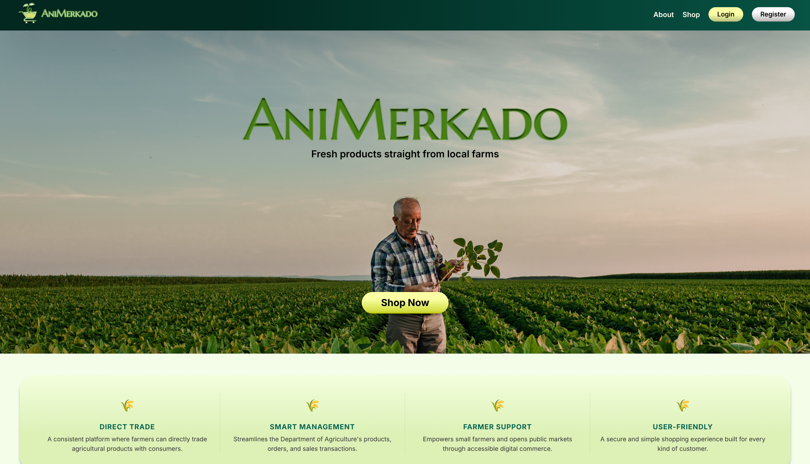 |
| Login Page | 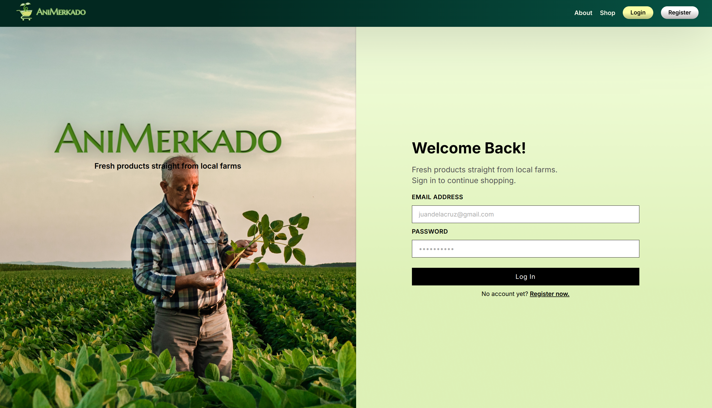 |
| Register Page | 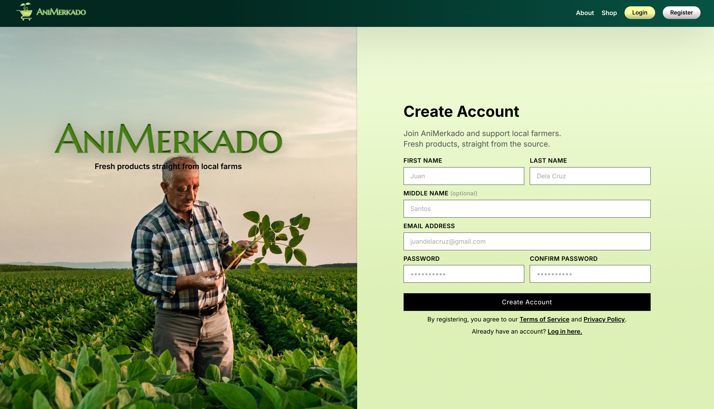 |
| Shop Page | 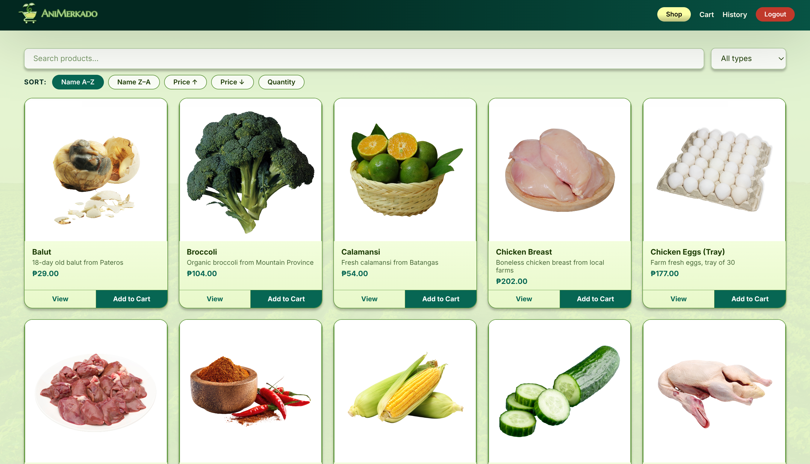 |
| Product Detail | 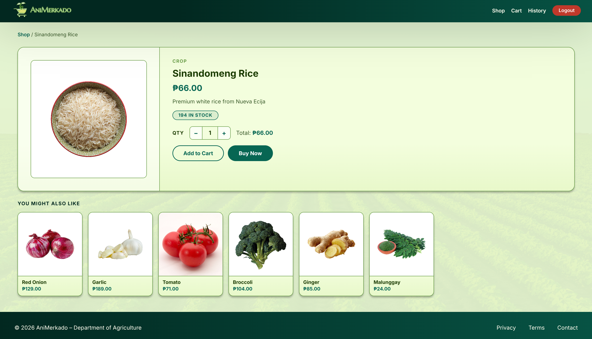 |
| Cart Page | 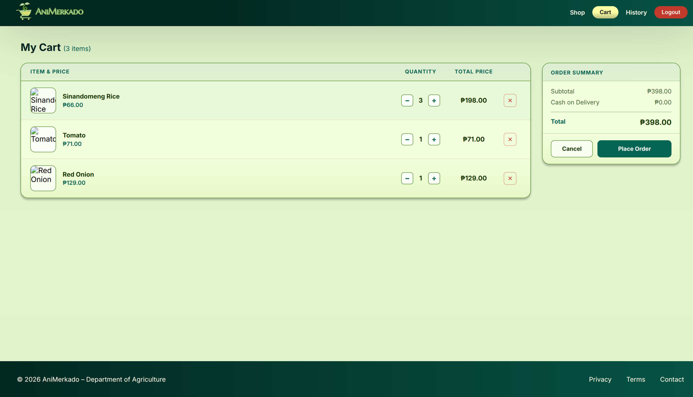 |
| Order History | 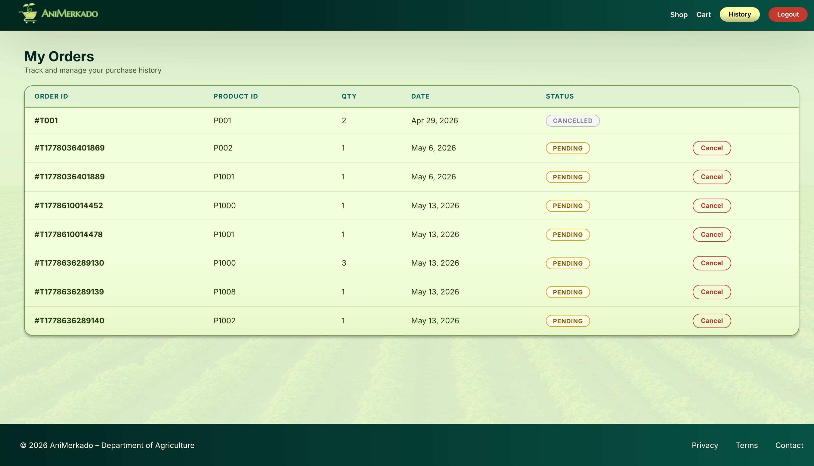 |
| Profile Page |  |
| Admin Dashboard | 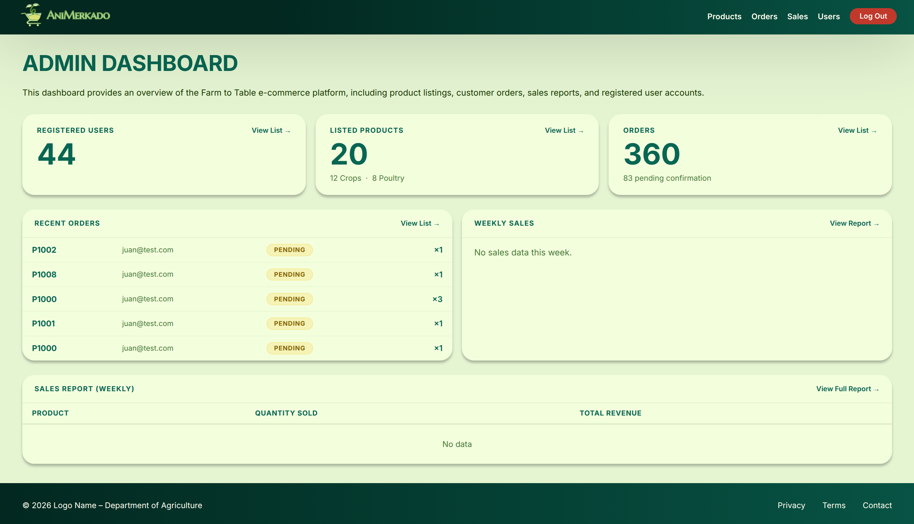 |
| User Management | 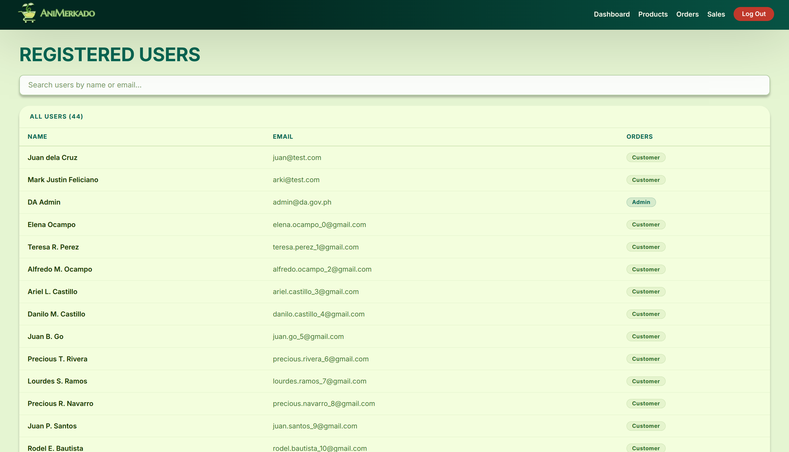 |
| Product Management | 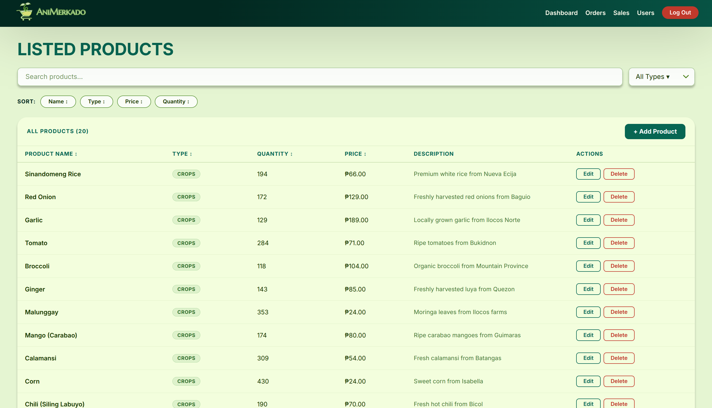 |
| Order Fulfillment |  |
| Sales Report | 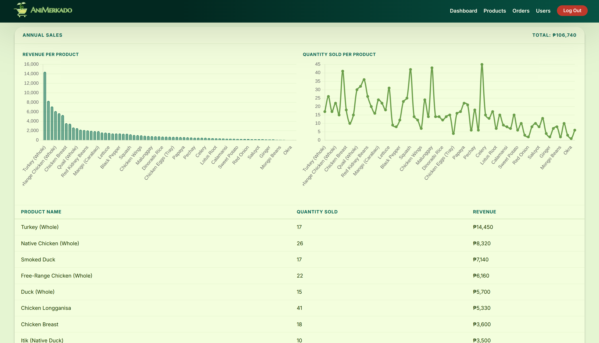 |

---

## 📁 Project Structure
```
final-project/
├── client/                          # React + Vite frontend
│   └── src/
│       ├── assets/
│       ├── pages/
│       │   ├── admin/
│       │   │   ├── Dashboard.jsx
│       │   │   ├── UserManagement.jsx
│       │   │   ├── ProductListings.jsx
│       │   │   ├── Products.jsx
│       │   │   ├── OrderFulfillment.jsx
│       │   │   └── SalesReport.jsx
│       │   ├── customer/
│       │   │   ├── Cart.jsx
│       │   │   ├── RegisterPage.jsx
│       │   │   ├── Shop.jsx
│       │   │   ├── ProductDetail.jsx
│       │   │   ├── OrderConfirmation.jsx
│       │   │   └── OrderHistory.jsx
│       │   └── default/
│       │       ├── LoginPage.jsx
│       │       └── LandingPage.jsx
│       ├── utils/
│       │   └── auth.js              # Shared auth headers and localStorage helpers
│       └── styles/
│           ├── admin/
│           │   ├── Dashboard.css
│           │   ├── UserManagement.css
│           │   ├── ProductListings.css
│           │   ├── OrderFulfillment.css
│           │   └── SalesReport.css
│           ├── customer/
│           │   ├── Cart.css
│           │   ├── RegisterPage.css
│           │   ├── Shop.css
│           │   ├── ProductDetail.css
│           │   ├── OrderConfirmation.css
│           │   └── OrderHistory.css
│           └── default/
│               ├── LoginPage.css
│               └── LandingPage.css
│
└── server/                          # Node.js + Express backend
    ├── index.js
    ├── router.js
    ├── seed.js
    ├── test.js
    ├── models/
    │   ├── User.js
    │   ├── Product.js
    │   ├── OrderTransaction.js
    │   ├── Cart.js
    │   └── Sale.js
    ├── controllers/
    │   ├── userController.js
    │   ├── productController.js
    │   ├── orderController.js
    │   ├── cartController.js
    │   └── salesController.js
    └── routes/
        ├── userRoutes.js
        ├── productRoutes.js
        ├── orderRoutes.js
        ├── cartRoutes.js
        └── salesRoutes.js
```

---

## 🛠️ Tech Stack

| Layer       | Technology           |
|-------------|----------------------|
| Frontend    | React JS + Vite      |
| Backend     | Node.js + Express JS |
| Database    | MongoDB (local)      |
| ODM         | Mongoose             |
| Auth        | bcrypt + JWT         |
| Charts      | Chart.js             |
| API Testing | needle               |

---

## ⚙️ Prerequisites

- Node.js v20+
- MongoDB v7+
- npm

---

## 🚀 How to Run

### 1. Start MongoDB
```bash
sudo systemctl start mongod
```

### 2. Seed the database (run once)
```bash
cd server
node seed.js
```
This creates the DA admin account with a hashed password.

### 3. Start the backend server
```bash
cd server
npm install
npm run dev
```
Server runs on `http://localhost:5000`

### 4. Start the frontend
```bash
cd client
npm install
npm run dev
```
Client runs on `http://localhost:5173`

---

## 📖 Usage Guidelines

### As a Customer
1. Go to `http://localhost:5173` and click **Register**
2. Fill in your details and create an account
3. Log in with your registered email and password
4. Browse the shop, add items to your cart, and place an order
5. View your order history and cancel pending orders if needed
6. Update your profile information from the profile page

### As an Admin (Department of Agriculture)
1. Log in using the seeded admin credentials
2. You will be automatically redirected to the admin dashboard
3. Use the sidebar to navigate between modules:
   - **User Management** — view all registered customers
   - **Product Listings** — add, edit, or delete products
   - **Order Fulfillment** — confirm or monitor customer orders
   - **Sales Report** — view weekly, monthly, or annual sales with charts

---

## 🔌 API Endpoints

### Users
| Method | Endpoint | Description |
|--------|----------|-------------|
| GET | `/api/users` | Get all users + total count (admin only) |
| POST | `/api/users/register` | Register a new customer |
| POST | `/api/users/login` | Login and receive JWT token |
| PUT | `/api/users/:email` | Update user profile information |

### Products
| Method | Endpoint | Description |
|--------|----------|-------------|
| GET | `/api/products` | Get all products (supports `?sort=&order=`) |
| POST | `/api/products` | Add a new product (admin only) |
| PUT | `/api/products/:productId` | Update a product (admin only) |
| DELETE | `/api/products/:productId` | Delete a product (admin only) |

### Orders
| Method | Endpoint | Description |
|--------|----------|-------------|
| GET | `/api/orders` | Get all orders (supports `?email=` filter) |
| POST | `/api/orders` | Create a new order |
| PUT | `/api/orders/:transactionId` | Confirm or update order status (admin only) |
| DELETE | `/api/orders/:transactionId` | Cancel a pending order |

### Cart
| Method | Endpoint | Description |
|--------|----------|-------------|
| GET | `/api/cart` | Get cart items (supports `?email=` filter) |
| POST | `/api/cart` | Add item to cart |
| DELETE | `/api/cart/:itemId` | Remove item from cart |

### Sales Reports
| Method | Endpoint | Description |
|--------|----------|-------------|
| GET | `/api/orders/sales` | Get sales report (requires `?filter=weekly/monthly/annual`) |

---

## 🗄️ Database

- **Database name:** `animerkado`
- **Collections:** `users`, `products`, `ordertransactions`, `carts`, `sales`
- MongoDB is run locally at `mongodb://127.0.0.1:27017`

### Data Models

**User** — `firstName`, `middleName` *(optional)*, `lastName`, `userType`, `email`, `password` *(bcrypt hashed)*

**Product** — `productId`, `productName`, `productDescription`, `productType` *(1 Crop / 2 Poultry)*, `productQuantity`, `price`

**OrderTransaction** — `transactionId`, `productId`, `orderQuantity`, `orderStatus` *(0 Pending / 1 Completed / 2 Canceled)*, `email`, `dateOrdered`, `time`

**Cart** — `email`, `productId`, `productName`, `quantity`, `price`

**Sale** — `orderId`, `productId`, `productName`, `quantity`, `price`, `total`, `date`

---

## 👥 User Types

| Type | Description |
|------|-------------|
| `customer` | Registered users — can browse products, manage cart, place orders, and manage their profile |
| `admin` | Department of Agriculture — manages products, orders, users, and views sales reports. Account is seeded directly into the database via `seed.js` |

---

## 🔐 Authentication

- Passwords are hashed using **bcrypt** before storing in MongoDB
- Login returns a **JWT token** stored in `localStorage` on the frontend
- Token is sent in the `Authorization` header for protected requests
- Admin-only routes are protected by middleware that verifies `userType`
- Unauthenticated users are redirected to `/login`
- Non-admin users are redirected away from `/admin/` routes

---

## 🧪 Testing the API

With the server running, execute the test script:
```bash
cd server
node test.js
```
This runs needle HTTP requests against all endpoints covering happy paths and edge cases, logging responses to the terminal.